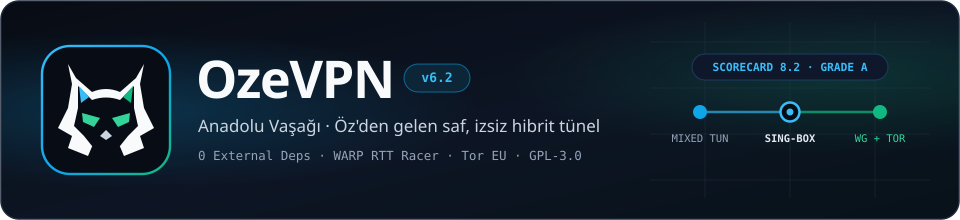
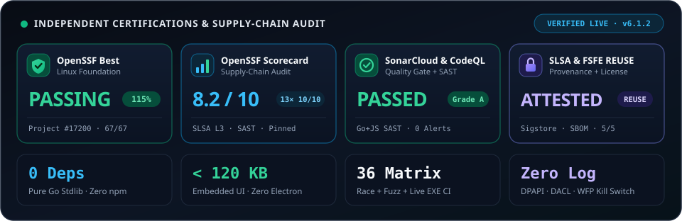
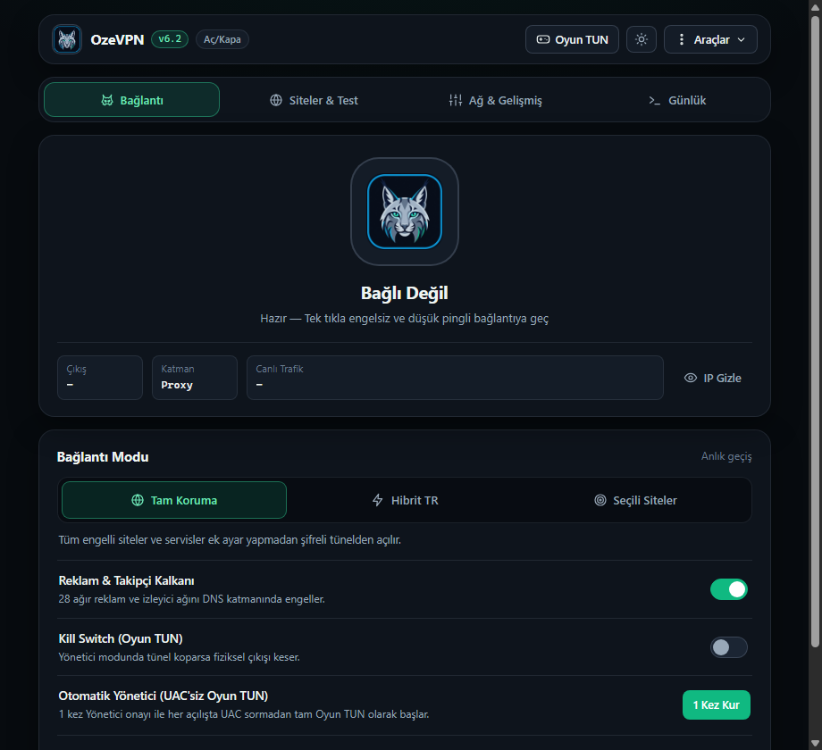
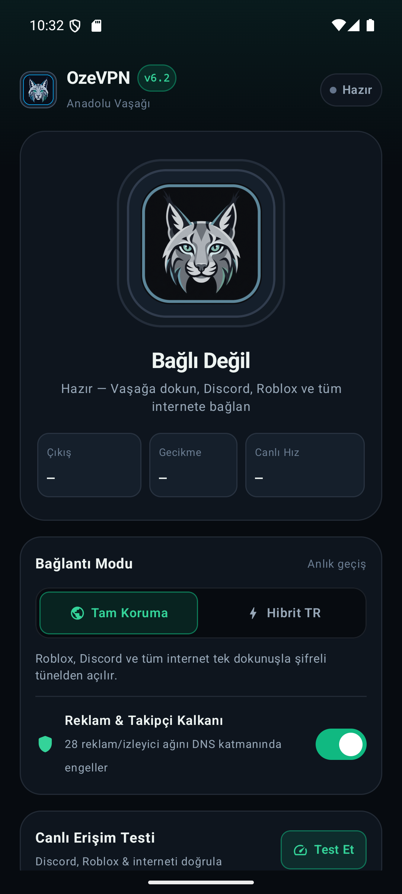
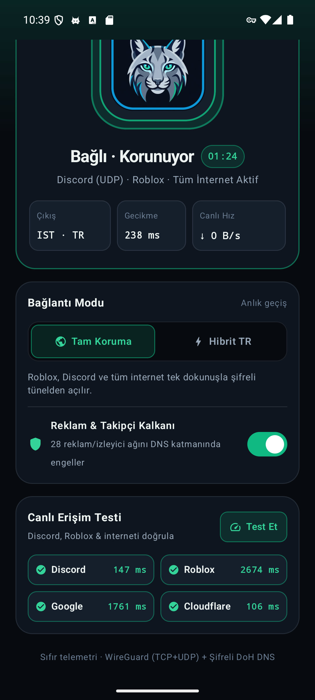
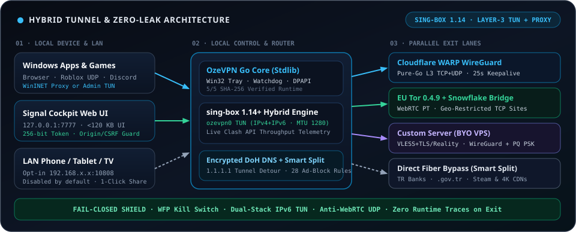

<div align="center">

<picture>
  <source media="(prefers-color-scheme: dark)" srcset="assets/banner-dark.svg">
  <source media="(prefers-color-scheme: light)" srcset="assets/banner-light.svg">
  
</picture>

<br/>
<br/>

**[🇹🇷 Türkçe](README.md) · 🇬🇧 English**

<p>
  <a href="https://www.bestpractices.dev/en/projects/17200"></a>
  <a href="https://scorecard.dev/viewer/?uri=github.com/KeremKalyoncu/ozevpn"></a>
  <a href="https://sonarcloud.io/summary/new_code?id=KeremKalyoncu_ozevpn"></a>
  <a href="https://sonarcloud.io/summary/new_code?id=KeremKalyoncu_ozevpn"></a>
</p>
<p>
  <a href="https://github.com/KeremKalyoncu/ozevpn/actions/workflows/ci.yml"></a>
  <a href="https://github.com/KeremKalyoncu/ozevpn/actions/workflows/android.yml"></a>
  <a href="https://github.com/KeremKalyoncu/ozevpn/actions/workflows/codeql.yml"></a>
  <a href="https://github.com/KeremKalyoncu/ozevpn/actions/workflows/release.yml"></a>
  <a href="https://api.reuse.software/info/github.com/KeremKalyoncu/ozevpn"></a>
  <a href="https://github.com/KeremKalyoncu/ozevpn/releases"></a>
  <a href="LICENSE"></a>
</p>

<h3>Zero third-party Go/npm dependencies. Single-file Windows desktop (<code>.exe</code>) and root-free <b>Android (<code>.apk</code>)</b> Anatolian Lynx hybrid VPN built for speed, gaming UDP, and zero leaks.</h3>

<p>
  <a href="https://keremkalyoncu.github.io/ozevpn/"><b>🌐 Download Page</b></a> ·
  <a href="#-certifications--independent-audits"><b>Certifications</b></a> ·
  <a href="#-live-preview--windows--android"><b>Preview & Android</b></a> ·
  <a href="#-why-ozevpn"><b>Comparison</b></a> ·
  <a href="#-architecture--defense-in-depth"><b>Architecture</b></a> ·
  <a href="#-quick-start"><b>Quick Start</b></a> ·
  <a href="#-verification--supply-chain"><b>Verification</b></a> ·
  <a href="CONTRIBUTING.md"><b>Contributing</b></a>
</p>

</div>

---

## 🏆 Certifications & Independent Audits

OzeVPN is continuously audited on every commit against **Linux Foundation OpenSSF**, **GitHub CodeQL**, **SonarCloud**, **Sigstore SLSA**, and **FSFE REUSE** standards.

<div align="center">
<picture>
  <source media="(prefers-color-scheme: dark)" srcset="assets/certifications-dark.svg">
  <source media="(prefers-color-scheme: light)" srcset="assets/certifications-light.svg">
  
</picture>
</div>

<br/>

| Independent Audit / Standard | Live Certificate & Badge | Verified Scope | Audit Record |
| :--- | :---: | :--- | :--- |
| **Linux Foundation OpenSSF Best Practices** | [](https://www.bestpractices.dev/en/projects/17200) | **115% Passing · 65% Silver** (`67/67` Passing + `36/55` Silver criteria) | [Project #17200](https://www.bestpractices.dev/en/projects/17200) |
| **OpenSSF Scorecard** | [](https://scorecard.dev/viewer/?uri=github.com/KeremKalyoncu/ozevpn) | **`8.2 / 10` (Grade A)** — **13 checks at `10/10`** | [Live Viewer](https://scorecard.dev/viewer/?uri=github.com/KeremKalyoncu/ozevpn) |
| **SonarCloud Quality & Security** | [](https://sonarcloud.io/summary/new_code?id=KeremKalyoncu_ozevpn) [](https://sonarcloud.io/summary/new_code?id=KeremKalyoncu_ozevpn) | Continuous static quality gate and **Grade A** security rating | [SonarCloud Dashboard](https://sonarcloud.io/summary/new_code?id=KeremKalyoncu_ozevpn) |
| **GitHub CodeQL SAST** | [](https://github.com/KeremKalyoncu/ozevpn/actions/workflows/codeql.yml) | Automated **Go + JavaScript** security scanning on every push, PR & schedule | [CodeQL Workflow](https://github.com/KeremKalyoncu/ozevpn/actions/workflows/codeql.yml) |
| **Sigstore SLSA Build Provenance** | [](https://github.com/KeremKalyoncu/ozevpn/actions/workflows/release.yml) | Cryptographic build attestation (`gh attestation verify`) + CycloneDX 1.5 SBOM | [Release Workflow](https://github.com/KeremKalyoncu/ozevpn/actions/workflows/release.yml) |
| **FSFE REUSE 3.3 License Compliance** | [](https://api.reuse.software/info/github.com/KeremKalyoncu/ozevpn) | Machine-readable `SPDX: GPL-3.0-or-later` coverage across all files | [REUSE Status](https://api.reuse.software/info/github.com/KeremKalyoncu/ozevpn) |
| **OzeVPN CI (Windows + Android)** | [](https://github.com/KeremKalyoncu/ozevpn/actions/workflows/ci.yml) [](https://github.com/KeremKalyoncu/ozevpn/actions/workflows/android.yml) | `go test -race`, fuzzing, `staticcheck`, `govulncheck`, Android Kotlin unit tests & release APK | [Windows CI](https://github.com/KeremKalyoncu/ozevpn/actions/workflows/ci.yml) · [Android CI](https://github.com/KeremKalyoncu/ozevpn/actions/workflows/android.yml) |
| **Releases, Stores & Distribution** | [](https://github.com/KeremKalyoncu/ozevpn/releases/tag/v6.2.0) | Windows `.exe` + signed Android `.apk` · Winget PR · IzzyOnDroid submission | [v6.2.0 Release](https://github.com/KeremKalyoncu/ozevpn/releases/tag/v6.2.0) · [Winget PR](https://github.com/microsoft/winget-pkgs/pull/491333) · [IzzyOnDroid](https://codeberg.org/IzzyOnDroid/repodata/issues/982) |

> [!IMPORTANT]
> **Audit Scope Transparency:** **OpenSSF Best Practices** is a voluntary self-certification program; **CodeQL**, **SonarCloud**, **OpenSSF Scorecard**, and **Sigstore SLSA** provide automated static and supply-chain verification—they do not replace an independent third-party penetration test *(independent audit applications have been submitted to OTF Security Lab and OSTIF)*. Windows releases are verified via `SHA-256`, **Sigstore Cosign**, and **SLSA Build Level 3 (`*.intoto.jsonl`)**; we plan to reapply for free Windows Authenticode signing via [SignPath Foundation](CODE_SIGNING_POLICY.md) as community visibility grows.

<details>
<summary><b>📊 OpenSSF Scorecard Breakdown — 13 Perfect <code>10/10</code> Checks (<code>8.2 / 10</code> · Grade A)</b></summary>

<br/>

| Scorecard Check | Score | Evidence |
| :--- | :---: | :--- |
| **Signed-Releases** | `10 / 10` | SLSA Build Level 3 `*.intoto.jsonl` + Sigstore Cosign signed releases |
| **Packaging** | `10 / 10` | Automated GoReleaser v2 build & release publishing pipeline |
| **License** | `10 / 10` | Verbatim 674-line FSF GNU [LICENSE](LICENSE) (`GPL-3.0`) + [REUSE.toml](REUSE.toml) |
| **SAST** | `10 / 10` | CodeQL (Go + JS · `0` alerts), `staticcheck@v0.8.2`, `go vet`, and SonarCloud (`A/A/A`) |
| **Fuzzing** | `10 / 10` | Native Go fuzz targets (`FuzzCleanDomain`, `FuzzParseCustomOutbound`) |
| **Vulnerabilities** | `10 / 10` | Zero known CVEs (`govulncheck@v1.10.0` + `0` external Go/npm dependencies) |
| **Security-Policy** | `10 / 10` | [SECURITY.md](SECURITY.md) — supported versions, 48h ack, 90d coordinated disclosure |
| **Pinned-Dependencies** | `10 / 10` | Every GitHub Actions step pinned to full 40-char commit SHA |
| **Token-Permissions** | `10 / 10` | Least-privilege workflow tokens (`permissions: contents: read` top-level) |
| **CI-Tests** | `10 / 10` | Race detector (`-race`), 36-combo `sing-box check` matrix, live Windows EXE test |
| **Binary-Artifacts** | `10 / 10` | Zero binaries checked into Git; embedded runtimes `5/5` SHA-256 pinned |
| **Dangerous-Workflow** | `10 / 10` | Zero dangerous workflow patterns or script injections |
| **Dependency-Update-Tool** | `10 / 10` | Automated weekly `Dependabot` (`.github/dependabot.yml`) |
| **CII-Best-Practices** | `5 / 10` | OpenSSF Best Practices **Passing (115%)** verified |

</details>

---

## 🖥️ Live Preview — Windows & Android

### 🪟 Windows Desktop (`v6.2.0` — Anatolian Lynx Cockpit)
Handcrafted **pure HTML/CSS/Vanilla JS (`< 120 KB` total embedded budget)** with **zero Electron overhead**, streamlined 4-tab layout, 3-state live system tray icon, and one-time elevated background task:

<div align="center">
  
</div>

### 📱 Android (`v6.2.0` — Root-Free 1-Tap Lynx VPN)
Zero-bloat **Kotlin + Jetpack Compose** native Android `VpnService` app powered by SHA-256 verified `sing-box` + `hev-socks5-tunnel`: tap the Anatolian Lynx for **Discord (voice/UDP) + Roblox + unrestricted internet** with dual-stack IPv4/IPv6 TUN, seamless Wi-Fi ↔ 4.5G/5G handover, and auto-recovering Watchdog.

| 🐾 Ready Screen | ✅ Connected & 4/4 Live Probe Verification |
| :---: | :---: |
|  |  |

---

## ⚡ Why OzeVPN?

Named after Turkish **"Öz"** *(core, pure, unadorned)* and **Oze** *(an unobstructed natural pass)*, OzeVPN is a local, telemetry-free desktop tunnel controller built strictly on Go's standard library — no Electron, no accounts, no cloud backend.

| Capability | Typical Free / Electron VPNs | OzeVPN v6.2.0 |
| :--- | :--- | :--- |
| **Platforms** | Single-platform Electron or ad-heavy mobile | **Windows (`.exe`) + Root-Free Native Android (`.apk`)** with shared WARP WireGuard core |
| **External Dependencies** | Hundreds of npm / Electron / SDK packages | **`0` external Go/npm modules** (pure Go stdlib + `<120 KB` Vanilla UI) |
| **Gaming UDP (Roblox / Discord Voice)** | Often TCP-only or geo-blocked exit POPs | **EU-POP prioritized WARP WireGuard (full L3 TCP+UDP, `MTU 1280`, `25s` keepalive)** |
| **Smart Split Tunneling** | Routes everything through slow nodes | **Direct bypass** for banking, `.gov`, and 4K/Steam CDNs + EU Tor for geo-restricted TCP |
| **Home Wi-Fi / Phone / TV Sharing** | Requires router flashing | **1-click LAN Proxy Sharing** (`192.168.x.x:10808`, opt-in, disabled by default) |
| **Real-Time Telemetry** | Static or fake counters | **Live throughput (`↓/↑ B/s` & session total)** via authenticated loopback `sing-box` API |
| **Leak & Crash Protection** | Silent leaks on crash | **Dual-stack IPv6 TUN + DoH detour + Windows Firewall WFP fail-closed Kill Switch** |
| **Privacy & Accounts** | Accounts, emails, analytics SDKs | **Zero accounts, zero telemetry**, Windows **DPAPI + NTFS DACL** secret isolation |

---

## 🧩 Architecture & Defense-in-Depth

<div align="center">
<picture>
  <source media="(prefers-color-scheme: dark)" srcset="assets/architecture-dark.svg">
  <source media="(prefers-color-scheme: light)" srcset="assets/architecture-light.svg">
  
</picture>
</div>

<br/>

<details>
<summary><b>🛡️ 8-Layer Security & Privacy Controls</b></summary>

<br/>

- **Local IPC Hardening:** Per-session 256-bit `crypto/rand` token (`/auth?t=...` → `HttpOnly; SameSite=Strict` cookie + required `X-OzeVPN-Token` header with `subtle.ConstantTimeCompare`), loopback-only `Host` check, `Origin`/`Sec-Fetch-Site` CSRF guard, rate & concurrency limiting.
- **Secret Isolation:** Custom server credentials and native WARP WireGuard private keys are encrypted via Windows **DPAPI** (`CryptProtectData`) and restricted with owner-only **NTFS DACL**. Active `sing-box-active.json` is deleted on disconnect.
- **Protocol Hardening:** Rejects plaintext `vless://`, remote plaintext `socks5://`, `allowInsecure=1`, and `tls.insecure: true`; supports WireGuard Post-Quantum `PresharedKey`; masks secrets in error logs (`RedactSecrets`).
- **Leak Protection & Kill Switch:** Dual-stack `IPv4 + IPv6` TUN (`fdfe:dcba:9876::1/126`), tunnel-detoured DoH DNS (`1.1.1.1`), `ipconfig /flushdns` on state transitions, WebRTC non-proxied UDP restriction, and fail-closed Windows Firewall (`OzeVPN-KS-*` + `blockoutbound`) Kill Switch in Admin `Oyun TUN` mode.
- **Anti-SSRF & Strict CSP:** Blocks RFC1918/loopback/link-local/`.local`/`.internal` on `/api/rescue`; strict `default-src 'self'` CSP with zero unsafe inline DOM sinks.

See [SECURITY.md](SECURITY.md), [PRIVACY.md](PRIVACY.md), [docs/THREAT-MODEL.md](docs/THREAT-MODEL.md), and the live Windows field report in [docs/VERIFICATION.md](docs/VERIFICATION.md) for full details.

</details>

---

## 🚀 Quick Start

### Option 1 — One-Line PowerShell Installer *(SHA-256 Verified, Recommended)*

```powershell
irm https://raw.githubusercontent.com/KeremKalyoncu/ozevpn/main/scripts/install.ps1 | iex
```

### Option 2 — Portable Single-EXE Download or Winget

1. Download `OzeVPN.exe` from [GitHub Releases (`v6.2.0`)](https://github.com/KeremKalyoncu/ozevpn/releases/tag/v6.2.0) and double-click.
2. Click **Oyun TUN** in the top bar for full-system `IPv4+IPv6+UDP` tunneling and WFP Kill Switch.
3. Clean uninstall anytime: `.\OzeVPN.exe -uninstall`.
4. **Winget:** Manifest submitted in [microsoft/winget-pkgs#491333](https://github.com/microsoft/winget-pkgs/pull/491333) (`winget install KeremKalyoncu.OzeVPN`).

### Option 3 — Native Android App (`.apk`, Android 10+ / No Root)

1. Download **`OzeVPN-Android-arm64.apk`** (`26.5 MB`, modern Android devices) or `OzeVPN-Android-universal.apk` from [GitHub Releases (`v6.2.0`)](https://github.com/KeremKalyoncu/ozevpn/releases/tag/v6.2.0).
2. Open OzeVPN, tap the **Anatolian Lynx** emblem, and grant the one-time Android VPN permission.
3. Includes EU-POP prioritized Cloudflare WARP WireGuard, dual-stack **IPv4 + IPv6 TUN**, automatic **Wi-Fi ↔ 4.5G/5G handover**, `sing-box` Watchdog, Quick Settings Tile, and 1-tap live reachability probes.

### Option 4 — Build from Source (Windows `amd64`, Go 1.22+ / 1.26+)

```powershell
go run ./cmd/ozevpn
gofmt -l . ; go vet ./... ; go test -race -cover ./...
.\scripts\build-single-exe.ps1
```

---

## 🔐 Verification & Supply Chain

```powershell
# 1. Verify SHA-256 checksum of downloaded OzeVPN.exe (v6.2.0)
(Get-FileHash .\OzeVPN.exe -Algorithm SHA256).Hash
# Expected: 3430E0363646DE2EF6E031BA45372948FD84E68DDCE2975AB737BE627E12082A

# 2. Verify Android APK SHA-256 checksum (v6.2.0)
(Get-FileHash .\OzeVPN-Android-arm64.apk -Algorithm SHA256).Hash
# Expected: 8551F83DEDD7721F49C40A4BD0143F6F2AE5D839463B351F0AE8DB63925539C4

# 3. Verify Sigstore SLSA Build Provenance via GitHub CLI
gh attestation verify OzeVPN-core.exe -R KeremKalyoncu/ozevpn
```

- **Android Signing Certificate (SHA-256):** `05:F7:B3:D9:28:4F:B0:2B:7D:FD:E8:4A:34:5B:78:46:67:5E:93:81:6E:DD:0C:3B:17:98:44:B1:90:D7:4C:45` (`CN=OzeVPN Release, O=OzeVPN, C=TR`)
- **VirusTotal:** [Public SHA-256 Scan Report](https://www.virustotal.com/gui/file/37ea85b678e37bfa02958fdd16d4513026e585351a9530d2899cfa287d931558)
- **SBOM:** `sbom.cdx.json` (CycloneDX 1.5) attached to every GitHub Release
- **Code Signing Policy:** [CODE_SIGNING_POLICY.md](CODE_SIGNING_POLICY.md) *(Android APKs permanently signed with 4096-bit RSA; Windows uses Sigstore Cosign + SLSA, planning to reapply to [SignPath Foundation](https://signpath.org/) as community grows)*

---

## 📄 License

Distributed under the **GNU General Public License v3.0 (`GPL-3.0-or-later`)** — see [LICENSE](LICENSE) and [THIRD_PARTY_LICENSES.md](THIRD_PARTY_LICENSES.md).
