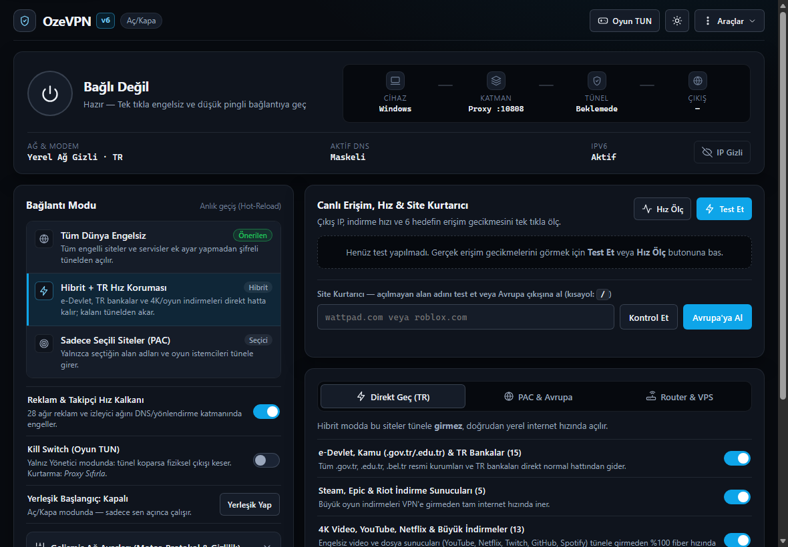
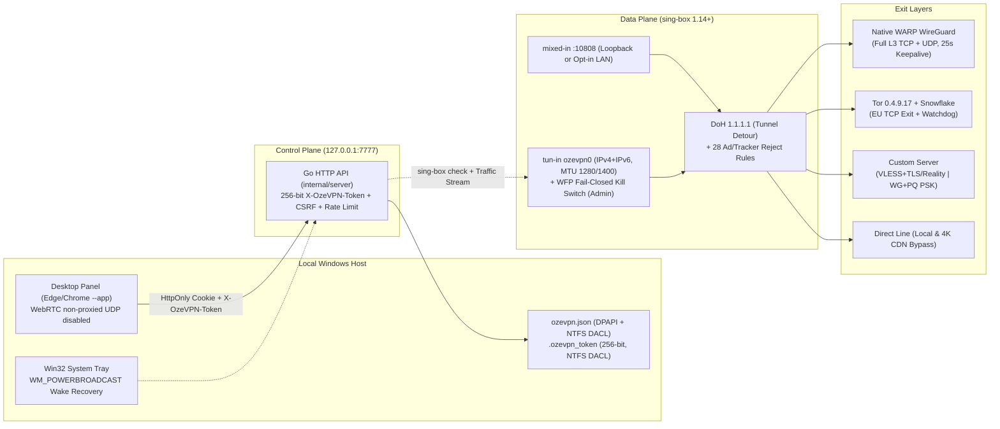

<div align="center">

<picture>
  <source media="(prefers-color-scheme: dark)" srcset="assets/banner-dark.svg">
  <source media="(prefers-color-scheme: light)" srcset="assets/banner-light.svg">
  
</picture>

<br/>
<br/>

**[Türkçe](README.md) · English**

[](https://github.com/KeremKalyoncu/ozevpn/actions/workflows/ci.yml)
[](https://github.com/KeremKalyoncu/ozevpn/actions/workflows/codeql.yml)
[](https://scorecard.dev/viewer/?uri=github.com/KeremKalyoncu/ozevpn)
[](https://sonarcloud.io/summary/new_code?id=KeremKalyoncu_ozevpn)
[](https://sonarcloud.io/summary/new_code?id=KeremKalyoncu_ozevpn)
[](https://api.reuse.software/info/github.com/KeremKalyoncu/ozevpn)
[](https://github.com/KeremKalyoncu/ozevpn/actions/workflows/release.yml)
[](https://github.com/KeremKalyoncu/ozevpn/releases)
[](LICENSE)

**Zero third-party Go/npm dependencies. Single-file Windows desktop VPN (`.exe`) combining native Cloudflare WARP WireGuard (`TCP+UDP`), EU Tor + Snowflake, smart split tunneling, LAN proxy sharing, live throughput telemetry, and a WFP Kill Switch.**

[Quick Start](#quick-start) · [Architecture](#architecture) · [Security](#security--privacy) · [Supply Chain](#verification--supply-chain) · [Contributing](CONTRIBUTING.md)

</div>

---

## Live Preview

<div align="center">
  
</div>

| Dark Theme (Obsidian Cockpit) | Light Theme (Cool Porcelain) |
| :---: | :---: |
|  |  |

---

## Why OzeVPN?

Named after Turkish **"Öz"** *(core, pure, unadorned)* and **Oze** *(an unobstructed natural pass)*, OzeVPN is a local, telemetry-free desktop tunnel controller built with pure Go stdlib and a `<120 KB` embedded Vanilla Web UI — no Electron, no accounts, no cloud backend.

| Capability | Typical Free VPNs | OzeVPN v6.1 |
| :--- | :--- | :--- |
| **External Dependencies** | Hundreds of npm / Electron / SDK packages | **`0` external Go/npm modules** (Go stdlib + `<120 KB` Vanilla UI) |
| **Gaming UDP (Roblox / Discord Voice)** | Often TCP-only SOCKS proxies | **Native pure-Go Cloudflare WARP WireGuard (full L3 TCP+UDP, `MTU 1280`, `25s` keepalive)** |
| **Smart Split Tunneling** | Routes everything through slow nodes | **Direct bypass** for banking, `.gov`, and 4K/Steam CDNs + EU Tor for geo-restricted TCP |
| **Home Wi-Fi / Phone / TV Sharing** | Requires router flashing | **1-click LAN Proxy Sharing** (`192.168.x.x:10808`, opt-in, disabled by default) |
| **Real-Time Telemetry** | Static or fake counters | **Live throughput (`↓/↑ B/s` & session total)** via authenticated loopback `sing-box` API |
| **Leak & Crash Protection** | Silent leaks on crash | **Dual-stack IPv6 TUN + DoH detour + Windows Firewall WFP fail-closed Kill Switch** |
| **Privacy & Accounts** | Accounts, emails, analytics SDKs | **Zero accounts, zero telemetry**, Windows **DPAPI + NTFS DACL** secret isolation |

---

## Architecture



---

## Security & Privacy

- **Local IPC Auth & CSRF:** Per-session 256-bit `crypto/rand` token (`HttpOnly; SameSite=Strict` + mandatory `X-OzeVPN-Token` on mutations), loopback-only `Host` check (DNS rebinding defense), `Origin`/`Sec-Fetch-Site` CSRF guard, rate & concurrency limits.
- **Secret Isolation:** Custom server credentials and native WARP WireGuard private keys are encrypted via Windows **DPAPI** (`CryptProtectData`) and restricted with owner-only **NTFS DACL**. Active `sing-box-active.json` is deleted on disconnect.
- **Protocol Hardening:** Rejects plaintext `vless://`, remote plaintext `socks5://`, `allowInsecure=1`, and `tls.insecure: true`; supports WireGuard Post-Quantum `PresharedKey`; masks secrets in error logs (`RedactSecrets`).
- **Leak Protection & Kill Switch:** Dual-stack `IPv4 + IPv6` TUN, tunnel-detoured DoH DNS, `ipconfig /flushdns` on state changes, WebRTC non-proxied UDP restriction, and optional Windows Firewall (`blockoutbound`) Kill Switch in Admin `Oyun TUN` mode.

See [SECURITY.md](SECURITY.md), [PRIVACY.md](PRIVACY.md), and [docs/THREAT-MODEL.md](docs/THREAT-MODEL.md) for full details.

---

## Verification & Supply Chain

- **CI Gates (`.github/workflows/ci.yml`):** SHA-pinned Actions, `gofmt`, `go vet`, `staticcheck`, `node --check`, `go test -race -cover ./...` (14 packages + 36-combination official `sing-box check` matrix), fuzzing, `govulncheck`, secret scan, and a **live Windows `ozevpn.exe` HTTP/security smoke test**.
- **Static & Supply-Chain Security:** `CodeQL` SAST (`Go` + `JavaScript`), Linux Foundation **OpenSSF Scorecard**, `Dependabot`, `5/5` bundled runtime SHA-256 pinning (`BINARY_CHECKSUMS.txt`), and **CycloneDX 1.5 SBOM**.
- **Cryptographic Provenance (SLSA Attestation):**
  ```powershell
  gh attestation verify OzeVPN-core.exe -R KeremKalyoncu/ozevpn
  ```

---

## Quick Start

### Option 1: One-Line PowerShell Installer (SHA-256 Verified)
```powershell
irm https://raw.githubusercontent.com/KeremKalyoncu/ozevpn/main/scripts/install.ps1 | iex
```

### Option 2: Portable Single-EXE Download
1. Download `OzeVPN.exe` from [Releases](https://github.com/KeremKalyoncu/ozevpn/releases) and double-click.
2. Click **Oyun TUN** in the top bar for full-system IPv4+IPv6+UDP tunneling and Kill Switch.
3. Clean uninstall anytime: `.\OzeVPN.exe -uninstall`.

### Build from Source (Windows `amd64`, Go 1.22+ / 1.26+)
```powershell
go run ./cmd/ozevpn
gofmt -l . && go vet ./... && go test -race -cover ./...
.\scripts\build-single-exe.ps1
```

---

## License
Licensed under the **GNU General Public License v3.0 (GPL-3.0)** — see [LICENSE](LICENSE) and [THIRD_PARTY_LICENSES.md](THIRD_PARTY_LICENSES.md).
