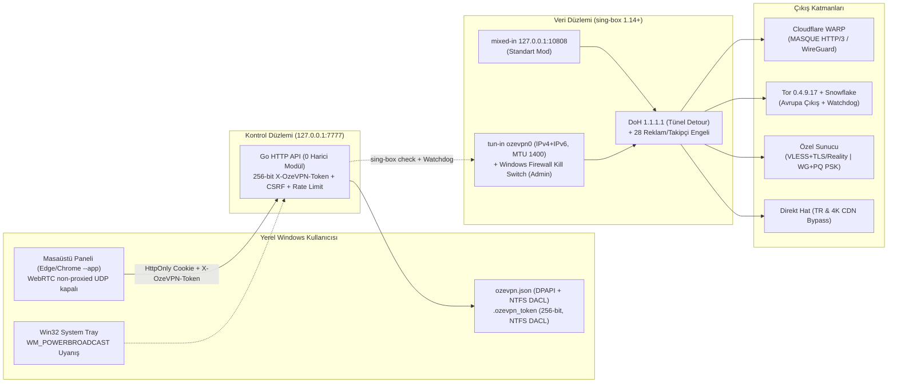

# OzeVPN v6

> **Sıfır üçüncü parti Go/npm bağımlılıklı, tek-dosya (`.exe`), hibrit yönlendirmeli ve sızıntı-korumalı yerel Windows masaüstü VPN & sansür aşma motoru.**

[](#kurulum--hızlı-başlangıç)
[](#mimari)
[](#mimari)
[-22C55E)](#güvenlik-ve-gizlilik-mimarisi)

---

## Öne Çıkan Özellikler

- **Tek Dosya Masaüstü Uygulaması (`dist/OzeVPN.exe`):** `sing-box 1.14.4`, `Tor 0.4.9.17`, `lyrebird` (Snowflake WebRTC PT) ve GeoIP veritabanlarını 5/5 SHA256 doğrulamayla tek ikilide toplar. Electron/Chromium şişkinliği olmadan yerel Edge/Chrome `--app` penceresi ve Win32 System Tray (özel kalkan ikonu) ile çalışır.
- **Paralel Hibrit Çıkış Motoru (4 Profil):**
  - **⚡ Hibrit (`hybrid_eu`, Varsayılan):** TR resmi (`.gov.tr`, `.edu.tr`), bankalar ve 4K/oyun indirme CDN'leri direkt tam hızda; TR çıkışında engellenen servisler (`roblox.com`, `wattpad.com` ve kullanıcı listesi) Avrupa Tor (`DE/NL/BG/RO/AT`) üzerinden; geri kalan tüm dünya düşük gecikmeli WARP (otomatik `MASQUE ↔ WireGuard`) üzerinden akar. WARP yanıt vermezse gerçek TCP port kontrolüyle kesintisiz Avrupa Tor'a devreder.
  - **🌍 Saf Avrupa Tor (`tor_eu`):** Harici kurulum gerektirmeden tüm trafiği Avrupa Tor (+ isteğe bağlı Snowflake köprü) üzerinden çıkarır.
  - **🚀 Sadece Hızlı WARP (`warp_fast`):** En düşük gecikmeli DPI aşma katmanı.
  - **🔑 Özel Sunucu (`custom`):** `VLESS+TLS/Reality`, **WireGuard `.conf` (Post-Quantum `PresharedKey` destekli)** veya izinli `sing-box` JSON.
- **Standart Proxy + Yönetici (`🎮 Oyun TUN`) Akıllı Geçişi:**
  - **Standart Mod:** UAC izni istemeden Windows WinINET proxy (`127.0.0.1:10808`) üzerinden tarayıcı ve proxy uyumlu uygulamaları korur.
  - **Yönetici Modu (`🎮 Oyun TUN`):** `-no-browser -takeover` ile mevcut pencereyi kapatmadan devralır; çift yığınlı (`IPv4 + IPv6`, `MTU 1400`) `ozevpn0` TUN arayüzü açar, oyun UDP trafiğini yakalar ve isteğe bağlı **Windows Firewall Fail-Closed Kill Switch**'i etkinleştirir.
- **Kesintisiz Hot-Reload & Site Kurtarıcı:** Kural, mod veya reklam kalkanı değişiklikleri `<1 sn` içinde canlı uygulanır. Açılmayan bir siteyi tek tıkla 3 yoldan test edip (`Direkt / Aktif Tünel / Avrupa Tor`) Avrupa çıkışına ekleyebilirsiniz.
- **Modern, Erişilebilir Arayüz:** Açık / Koyu tema (`prefers-color-scheme`), WCAG 2.2 AA kontrast, WAI-ARIA klavye erişimi, ekran paylaşımı için tek tık IP/MAC maskeleme ve `<120 KB` toplam web bütçesi.

---

## Mimari



---

## Güvenlik ve Gizlilik Mimarisi

OzeVPN, kapsamlı **Master VPN Audit v2.0** (18 kategori, 155 kontrol) kapsamında sertleştirilmiş ve **`88.7 / 100` (`122 PASS`, `0 FAIL`)** doğrulanmış puanla test edilmiştir:

| Katman | Uygulanan Güvenlik Kontrolü |
| :--- | :--- |
| **Yerel IPC & Kimlik** | Her oturumda `crypto/rand` 256-bit token (`/auth?t=...` → `HttpOnly; SameSite=Strict` + tüm mutasyonlarda zorunlu `X-OzeVPN-Token`), `Host` DNS-Rebinding & `Origin`/`Sec-Fetch-Site` CSRF engeli, rate/concurrency limit. |
| **Anahtar & Dosya İzolasyonu** | `custom_server` sırları Windows **DPAPI** (`CryptProtectData`) ile şifrelenir; `ozevpn.json`, `.ozevpn_token`, runtime ve log dosyalarına NTFS DACL (yalnız sahip + `SYSTEM` + `Administrators`, miras kapalı) uygulanır. Bağlantı kesildiğinde `sing-box-active.json` silinir. |
| **Protokol Sertleştirme** | Şifresiz `vless://`, uzak düz metin `socks5://`, `allowInsecure=1` ve ham JSON `tls.insecure:true` reddedilir; WireGuard resmi Post-Quantum `PresharedKey` desteklenir; hata çıktılarında sırlar maskelenir (`RedactSecrets`). |
| **Sızıntı Koruması** | Dual-stack `IPv4 + IPv6` TUN (`fdfe:dcba:9876::1/126`), aktif tünel `detour`'lu şifreli DoH DNS (`1.1.1.1`), bağlantı geçişlerinde `ipconfig /flushdns`, UI WebRTC non-proxied UDP engeli ve opsiyonel LAN izolasyonu. |
| **Kill Switch & Dayanıklılık** | Yönetici TUN modunda WFP tabanlı Windows Firewall `OzeVPN-KS-*` + `blockoutbound` Kill Switch, çift `sing-box` + `tor` Watchdog (5s→60s üstel backoff), uyku/uyanma (`WM_POWERBROADCAST`) ve ağ değişimi kurtarması. |
| **Tedarik Zinciri & Gizlilik** | `0` harici Go/npm bağımlılığı, 5/5 çalışma zamanı SHA256 sabitlemesi (`BINARY_CHECKSUMS.txt`), CycloneDX 1.5 SBOM, CI `govulncheck` + fuzzing kapısı, sıfır telemetri ve başlangıç harici sorgu kapatma anahtarı. |

> [!NOTE]
> **Kapsam Şeffaflığı:** Standart (yönetici olmayan) mod yalnızca Windows WinINET proxy kullanan tarayıcı/uygulamaları korur; tüm sistem (IPv4+IPv6+UDP) ve Kill Switch koruması için paneldeki **🎮 Oyun TUN** (Yönetici) modunu kullanın. Ayrıntılar için bkz. [PRIVACY.md](PRIVACY.md).

---

## Ölçülen Performans ve Kaynak Profili

| Metrik | Doğrulanmış Ölçüm |
| :--- | :--- |
| **WARP Tünel Hızı / Gecikme** | `58.1 Mbps`, `30 ms` ping, `11 ms` jitter *(canlı E2E)* |
| **Tor EU Yedek Tünel (`TXL`)** | `4.3 Mbps`, `p50=131.3 ms`, `%0.0` kayıp *(canlı `tools/bench`)* |
| **Aktif Yük Altında CPU** | `OzeVPN` `%0.17` • `sing-box` `%0.49` • `tor` `%1.98` *(toplam `< %2.7`)* |
| **Bellek Kullanımı** | `sing-box` `~36.5 MB` • `OzeVPN` `~73.5 MB` *(57 MB gömülü EXE dahil)* |
| **Hot-Reload / Admin Geçişi** | Hot-Reload `< 1 sn` • `-takeover` Admin geçişi `1.39 sn` |
| **Fuzzing & Race Kararlılığı** | 14/14 paket `go test -race` yeşil • `595.453` fuzz girdisi, `0` çökme |

---

## Kurulum & Hızlı Başlangıç

### Son Kullanıcı (Tek Dosya `.exe`)
1. `dist\OzeVPN.exe` dosyasını çalıştırın (veya masaüstü kısayoluna çift tıklayın).
2. Kontrol paneli otomatik olarak güvenli oturumla açılır ve Sistem Tepsisine (Tray) yerleşir.
3. Tam sistem / oyun UDP / Kill Switch koruması için üst çubuktan **🎮 Oyun TUN** butonuna tıklayın.
4. **Tam Temiz Kaldırma:**
   ```powershell
   .\dist\OzeVPN.exe -uninstall
   ```

### Geliştirici: Test, Benchmark ve Tek-EXE Derleme
Gereksinimler: **Go 1.22+** (Windows `amd64`) ve `BINARY_CHECKSUMS.txt` ile eşleşen `bin/` ikilileri.

```powershell
# Statik analiz, race detector, tüm birim/güvenlik/lab/sing-box şema testleri
go vet ./...
go test -race -cover ./...

# Canlı Baseline vs Tünel performans & p50/p95/p99 benchmark
go run ./tools/bench -samples 10 -bytes 3000000

# 5/5 SHA256 doğrulamalı tek-dosya EXE + CycloneDX SBOM derlemesi
.\build-single-exe.ps1
```

---

## Faz 2: Tüm Ev (OpenWrt Router) & Kendi VPS'in

- **OpenWrt Router (`sing-box 1.14+` + SQM/CAKE):** Panelden `sing-box-openwrt.json` dışa aktarın ve [router/openwrt-setup.sh](router/openwrt-setup.sh) ile [router/README.md](router/README.md) adımlarını izleyin.
- **Kendi Avrupa VPS'in (WireGuard + PQ PSK + BBR + UFW):** Ubuntu/Debian sunucuda [vps/setup-vps.sh](vps/setup-vps.sh) betiğini çalıştırın — default-deny UFW, SSH sertleştirme, Cloud Metadata (`169.254.0.0/16`) engeli, `chrony` ve `unattended-upgrades` otomatik kurulur.

---

## Dokümantasyon

| Belge | İçerik |
| :--- | :--- |
| [SECURITY.md](SECURITY.md) | Güvenlik savunma katmanları, acil Proxy/Kill Switch kurtarma ve güncelleme prosedürü |
| [PRIVACY.md](PRIVACY.md) | Veri akışları, harici çağrılar, anonimlik sınırları ve saklama politikası |
| [docs/ARCHITECTURE.md](docs/ARCHITECTURE.md) | Mimari Karar Kayıtları (`ADR-001` – `ADR-007`) |
| [docs/THREAT-MODEL.md](docs/THREAT-MODEL.md) | Varlık envanteri, güven sınırları ve tam STRIDE matrisi |
| [docs/OPERATIONS.md](docs/OPERATIONS.md) | İstemci SLO hedefleri, `/api/healthz`, `/api/metrics` ve anahtar rotasyon runbook'u |
| [THIRD_PARTY_LICENSES.md](THIRD_PARTY_LICENSES.md) | Gömülü üçüncü parti bileşenler ve lisans bildirimi (SBOM) |
