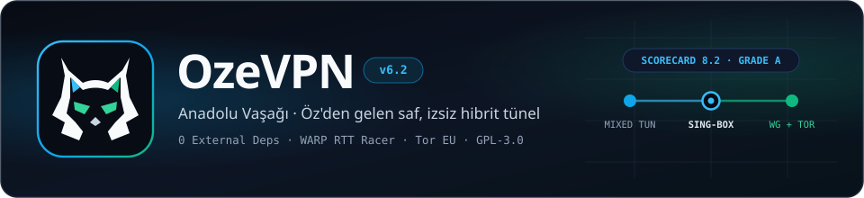
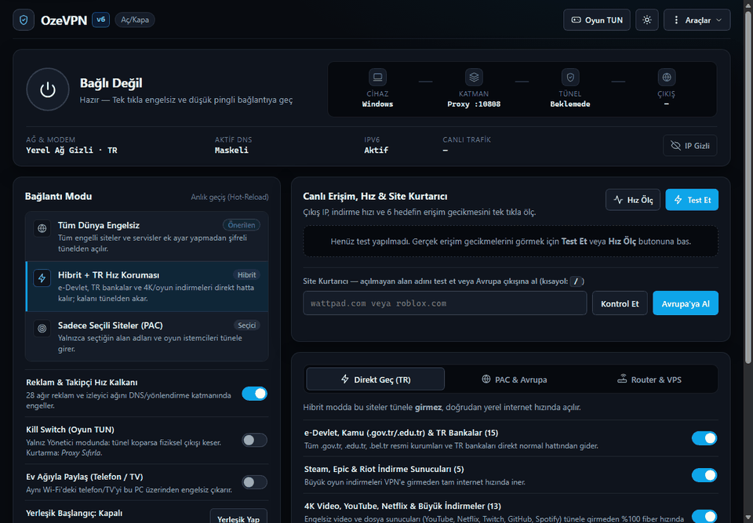

<div align="center">

<picture>
  <source media="(prefers-color-scheme: dark)" srcset="assets/banner-dark.svg">
  <source media="(prefers-color-scheme: light)" srcset="assets/banner-light.svg">
  
</picture>

<br/>
<br/>

**🇹🇷 Türkçe · [🇬🇧 English](README.en.md)**

<p>
  <a href="https://www.bestpractices.dev/en/projects/17200"></a>
  <a href="https://scorecard.dev/viewer/?uri=github.com/KeremKalyoncu/ozevpn"></a>
  <a href="https://sonarcloud.io/summary/new_code?id=KeremKalyoncu_ozevpn"></a>
  <a href="https://sonarcloud.io/summary/new_code?id=KeremKalyoncu_ozevpn"></a>
</p>
<p>
  <a href="https://github.com/KeremKalyoncu/ozevpn/actions/workflows/ci.yml"></a>
  <a href="https://github.com/KeremKalyoncu/ozevpn/actions/workflows/codeql.yml"></a>
  <a href="https://github.com/KeremKalyoncu/ozevpn/actions/workflows/release.yml"></a>
  <a href="https://api.reuse.software/info/github.com/KeremKalyoncu/ozevpn"></a>
  <a href="https://github.com/KeremKalyoncu/ozevpn/releases"></a>
  <a href="LICENSE"></a>
</p>

<h3>Sıfır üçüncü parti Go/npm bağımlılıklı, tek-dosya (<code>.exe</code>) Windows hibrit VPN ve sansür aşım uygulaması.</h3>

<p>
  <a href="#-sertifikalar--bağımsız-denetimler"><b>Sertifikalar</b></a> ·
  <a href="#-canlı-arayüz--signal-cockpit-ui"><b>Arayüz</b></a> ·
  <a href="#-neden-ozevpn"><b>Karşılaştırma</b></a> ·
  <a href="#-mimari--sıfır-sızıntı-tasarımı"><b>Mimari</b></a> ·
  <a href="#-kurulum--hızlı-başlangıç"><b>Kurulum</b></a> ·
  <a href="#-bütünlük--tedarik-zinciri-doğrulama"><b>Doğrulama</b></a> ·
  <a href="CONTRIBUTING.md"><b>Katkı</b></a>
</p>

</div>

---

## 🏆 Sertifikalar & Bağımsız Denetimler

OzeVPN, yalnızca kod yazıp bırakılmış bir araç değil; **Linux Foundation OpenSSF**, **GitHub CodeQL**, **SonarCloud**, **Sigstore SLSA** ve **FSFE REUSE** standartlarıyla her commit'te otomatik olarak denetlenen, şeffaf ve doğrulanabilir bir güvenlik projesidir.

<div align="center">
<picture>
  <source media="(prefers-color-scheme: dark)" srcset="assets/certifications-dark.svg">
  <source media="(prefers-color-scheme: light)" srcset="assets/certifications-light.svg">
  
</picture>
</div>

<br/>

| Bağımsız Denetim / Standart | Canlı Sertifika & Rozet | Doğrulanan Kapsam | Denetim Kaydı |
| :--- | :---: | :--- | :--- |
| **Linux Foundation OpenSSF Best Practices** | [](https://www.bestpractices.dev/en/projects/17200) | **%115 Passing** (`67/67` güvenlik, kriptografi, test ve sürüm kriteri) | [Proje #17200](https://www.bestpractices.dev/en/projects/17200) |
| **OpenSSF Scorecard** | [](https://scorecard.dev/viewer/?uri=github.com/KeremKalyoncu/ozevpn) | **`7.2 / 10`** — **10 kategoride tam `10/10`** + `License 9/10` | [Canlı Rapor](https://scorecard.dev/viewer/?uri=github.com/KeremKalyoncu/ozevpn) |
| **SonarCloud Quality & Security** | [](https://sonarcloud.io/summary/new_code?id=KeremKalyoncu_ozevpn) [](https://sonarcloud.io/summary/new_code?id=KeremKalyoncu_ozevpn) | Sürekli statik kalite kapısı ve **Grade A** güvenlik derecesi | [SonarCloud Paneli](https://sonarcloud.io/summary/new_code?id=KeremKalyoncu_ozevpn) |
| **GitHub CodeQL SAST** | [](https://github.com/KeremKalyoncu/ozevpn/actions/workflows/codeql.yml) | Her push, PR ve haftalık planda **Go + JavaScript** güvenlik taraması | [CodeQL Akışı](https://github.com/KeremKalyoncu/ozevpn/actions/workflows/codeql.yml) |
| **Sigstore SLSA Build Provenance** | [](https://github.com/KeremKalyoncu/ozevpn/actions/workflows/release.yml) | Kriptografik derleme kanıtı (`gh attestation verify`) + CycloneDX 1.5 SBOM | [Release Akışı](https://github.com/KeremKalyoncu/ozevpn/actions/workflows/release.yml) |
| **FSFE REUSE 3.3 Lisans Uyumu** | [](https://api.reuse.software/info/github.com/KeremKalyoncu/ozevpn) | Tüm kaynak ve varlıklarda makine-okunur `SPDX: GPL-3.0-or-later` uyumu | [REUSE Raporu](https://api.reuse.software/info/github.com/KeremKalyoncu/ozevpn) |
| **OzeVPN CI (Race + Fuzz + Canlı EXE)** | [](https://github.com/KeremKalyoncu/ozevpn/actions/workflows/ci.yml) | `go test -race`, fuzzing, `staticcheck`, `govulncheck`, canlı Windows `.exe` testi | [CI Akışı](https://github.com/KeremKalyoncu/ozevpn/actions/workflows/ci.yml) |
| **VirusTotal & Windows Dağıtımı** | [](https://github.com/KeremKalyoncu/ozevpn/releases/tag/v6.1.1) | `v6.1.1` SHA-256 taranmış ikili · Winget PR · SignPath kod imzalama başvurusu | [VirusTotal](https://www.virustotal.com/gui/file/37ea85b678e37bfa02958fdd16d4513026e585351a9530d2899cfa287d931558) · [Winget PR](https://github.com/microsoft/winget-pkgs/pull/491333) |

<details>
<summary><b>📊 OpenSSF Scorecard Detay Dökümü — 10 Kategoride Tam <code>10/10</code></b></summary>

<br/>

| Scorecard Kontrolü | Puan | Kanıt / Uygulama |
| :--- | :---: | :--- |
| **SAST** | `10 / 10` | CodeQL (Go + JS) + `staticcheck` + `go vet` + SonarCloud her commit'te zorunlu |
| **Fuzzing** | `10 / 10` | Go native fuzzing (`FuzzCleanDomain`, `FuzzParseCustomOutbound`) |
| **Vulnerabilities** | `10 / 10` | 0 bilinen güvenlik açığı (`govulncheck` + `0` harici bağımlılık) |
| **Security-Policy** | `10 / 10` | [SECURITY.md](SECURITY.md) — desteklenen sürümler, 48s yanıt, 90g koordineli açıklama |
| **Pinned-Dependencies** | `10 / 10` | Tüm GitHub Actions adımları tam 40-karakter commit SHA ile sabitli |
| **Token-Permissions** | `10 / 10` | En az ayrıcalık ilkesi (`permissions: contents: read` üst düzey) |
| **CI-Tests** | `10 / 10` | Her PR ve push'ta yarış algılayıcı (`-race`) + canlı Windows `.exe` testi |
| **Binary-Artifacts** | `10 / 10` | Git reposunda sıfır ikili dosya (yalnız kaynak kod; runtime'lar `5/5` SHA-256 pinli) |
| **Dangerous-Workflow** | `10 / 10` | Tehlikeli workflow kalıbı (script injection / `pull_request_target`) yok |
| **Dependency-Update-Tool** | `10 / 10` | Otomatik haftalık `Dependabot` (`.github/dependabot.yml`) aktif |
| **License** | `9 / 10` | Kök [LICENSE](LICENSE) (`GPL-3.0`) + [REUSE.toml](REUSE.toml) |
| **CII-Best-Practices** | `5 / 10` | OpenSSF Best Practices **Passing (%115)** sertifikası doğrulandı |

</details>

---

## 🖥️ Canlı Arayüz — Signal Cockpit UI

Electron şişkinliği olmadan **saf HTML/CSS/Vanilla JS (`< 120 KB` toplam gömülü paket)** ile yazılmış, koyu (`Obsidian Cockpit`) ve açık (`Cool Porcelain`) temalı yerel kontrol kokpiti:

<div align="center">
  
</div>

<br/>

| 🌑 Obsidian Cockpit (Koyu Tema) | ☀️ Cool Porcelain (Açık Tema) |
| :---: | :---: |
|  |  |

### Öne Çıkan Yetenekler

<table>
  <tr>
    <td width="50%" valign="top">
      <b>🎮 Yerleşik WARP WireGuard (Tam Layer-3 TCP+UDP)</b><br/>
      Harici kurulum olmadan <code>sing-box 1.14+</code> içinde saf-Go X25519 kaydıyla çalışır. <b>Roblox (Error 279 koruması)</b>, <b>Discord Ses (UDP)</b> ve çevrimiçi oyunlar için <code>MTU 1280</code> + <code>25 sn</code> CGNAT keepalive sağlar; UDP engellenirse otomatik yedek hatta geçer.
    </td>
    <td width="50%" valign="top">
      <b>🇪🇺 Paralel Avrupa Tor + Snowflake Köprüsü</b><br/>
      Bölge kilitli siteler (<code>paypal.com</code>, <code>booking.com</code>, <code>wattpad.com</code> ve kendi listen) için ayrı TCP tüneli; sansürlü ağlarda yerleşik <code>lyrebird</code> Snowflake WebRTC köprüsü ve çift Watchdog kurtarma.
    </td>
  </tr>
  <tr>
    <td width="50%" valign="top">
      <b>📡 Ev Ağıyla Paylaşım (LAN Proxy — Telefon / TV)</b><br/>
      Varsayılan <b>kapalı</b> tek bir anahtarla aynı Wi-Fi'deki telefon, tablet ve akıllı TV'leri router flashlamadan bu PC üzerinden engelsiz çıkarır (<code>192.168.x.x:10808</code>).
    </td>
    <td width="50%" valign="top">
      <b>📈 Canlı Hız & Oturum Veri Sayacı</b><br/>
      Oturuma özel rastgele gizli anahtarla korunan yerel <code>sing-box</code> Clash akışından anlık <code>↓/↑ B/s</code> indirme/yükleme hızını ve toplam veri tüketimini canlı gösterir.
    </td>
  </tr>
  <tr>
    <td width="50%" valign="top">
      <b>⚡ Akıllı Hibrit Split & Oyun TUN</b><br/>
      <code>.gov.tr</code>, bankalar ve Steam/4K CDN'leri tam fiber hızında direkt akar. Standart mod UAC istemez; tek tıkla <b>Oyun TUN</b> (Yönetici) moduna geçip dual-stack <code>IPv4+IPv6</code> TUN + <b>WFP Kill Switch</b> açılır.
    </td>
    <td width="50%" valign="top">
      <b>🛠️ Özel Sunucu (BYO VPS) & Tek Tık Tanılama</b><br/>
      <code>VLESS+TLS/Reality</code> ve Post-Quantum <code>PresharedKey</code> destekli WireGuard <code>.conf</code> içe aktarımı (Windows DPAPI şifreli) + maskelenmiş <b>Araçlar → Tanılama Kopyala</b> hata raporu aracı.
    </td>
  </tr>
</table>

---

## ⚡ Neden OzeVPN?

Türkçe **"Öz"** *(çekirdek, saf, aracısız)* ve el değmemiş doğal geçit **Oze** kavramlarından adını alan **OzeVPN**, abonelik satmayan, telemetri toplamayan ve tek yürütülebilir dosyada tam şeffaflık sunan saf bir yerel tünel denetleyicisidir.

| Özellik | Klasik Ücretsiz / Electron VPN'ler | OzeVPN v6.1.1 |
| :--- | :--- | :--- |
| **Harici Kod Bağımlılığı** | Yüzlerce npm / Electron / üçüncü parti SDK | **`0` harici Go/npm bağımlılığı** (saf Go stdlib + `<120 KB` Vanilla UI) |
| **Oyun UDP (Roblox / Discord Ses)** | Çoğu ücretsiz proxy yalnız TCP | **Yerleşik saf-Go WARP WireGuard (Tam L3 TCP+UDP, `MTU 1280`, `25s` keepalive)** |
| **TR Bankalar & 4K İndirme Hızı** | Tüm trafik tünele girer, gecikme artar | **Akıllı Hibrit Split:** `.gov.tr`, bankalar ve 4K/Steam CDN'leri direkt fiber hızında |
| **AB Konum Gerektiren Siteler** | Bölge kilitli veya ücretli sunucu | **Paralel Avrupa Tor + Snowflake WebRTC köprüsü** (sıfır harici kurulum) |
| **Ev İçi Telefon / TV Paylaşımı** | Router ayarı veya ek uygulama | **Tek tıkla LAN Proxy Paylaşımı** (`192.168.x.x:10808`, opt-in) |
| **Sızıntı & Çökme Koruması** | Çökünce gerçek IP / DNS sızar | **Dual-stack IPv6 TUN + DoH Detour + Windows Firewall WFP Fail-Closed Kill Switch** |
| **Gizlilik & Hesap** | Hesap, e-posta, log, analitik | **Sıfır hesap, sıfır sunucu, sıfır telemetri**, DPAPI + NTFS DACL izolasyonu |

---

## 🧩 Mimari & Sıfır Sızıntı Tasarımı

<div align="center">
<picture>
  <source media="(prefers-color-scheme: dark)" srcset="assets/architecture-dark.svg">
  <source media="(prefers-color-scheme: light)" srcset="assets/architecture-light.svg">
  
</picture>
</div>

<br/>

> [!NOTE]
> **Kapsam Şeffaflığı:** Standart (yönetici olmayan) mod yalnızca Windows WinINET proxy kullanan tarayıcı/uygulamaları korur; tüm sistem (`IPv4+IPv6+UDP`), oyun trafiği ve **WFP Kill Switch** koruması için paneldeki **Oyun TUN** (Yönetici) modunu kullanın. Ayrıntılar için bkz. [PRIVACY.md](PRIVACY.md).

<details>
<summary><b>🛡️ Derinlemesine Savunma (Defense-in-Depth) Güvenlik Matrisi — 8 Katman</b></summary>

<br/>

| Savunma Katmanı | Uygulanan Gerçek Güvenlik Kontrolü |
| :--- | :--- |
| **1. Yerel IPC & Kimlik** | Her oturumda `crypto/rand` 256-bit token (`/auth?t=...` → `HttpOnly; SameSite=Strict` + tüm mutasyonlarda zorunlu `X-OzeVPN-Token` + `subtle.ConstantTimeCompare`), rate & concurrency limit. |
| **2. Anti-CSRF & DNS Rebinding** | `r.Host` yalnız loopback (`127.0.0.1`/`localhost`/`::1`), sıkı `Origin` & `Sec-Fetch-Site` doğrulaması (`403`) + yapısal `slog` güvenlik kaydı. |
| **3. Anahtar & Dosya İzolasyonu** | `custom_server` ve yerleşik WARP WireGuard özel anahtarları Windows **DPAPI** (`CryptProtectData`) ile şifrelenir; tüm durum/log dosyalarına yalnız mevcut kullanıcıya özel **NTFS DACL** uygulanır. Çıkışta `sing-box-active.json` silinir. |
| **4. Protokol Sertleştirme** | Şifresiz `vless://`, uzak düz metin `socks5://`, `allowInsecure=1` ve ham JSON `tls.insecure:true` reddedilir; WireGuard Post-Quantum `PresharedKey` desteklenir; loglarda sırlar maskelenir (`RedactSecrets`). |
| **5. Sızıntı Koruması** | Dual-stack `IPv4 + IPv6` TUN (`fdfe:dcba:9876::1/126`), tünel `detour`'lu şifreli DoH DNS (`1.1.1.1`), bağlantı geçişlerinde `ipconfig /flushdns`, UI WebRTC non-proxied UDP engeli ve opsiyonel LAN izolasyonu. |
| **6. Kill Switch & Watchdog** | Yönetici TUN modunda WFP tabanlı Windows Firewall `OzeVPN-KS-*` + `blockoutbound` fail-closed Kill Switch, çift `sing-box`+`tor` Watchdog (`5s → 60s` backoff) ve `WM_POWERBROADCAST` uyanış kurtarması. |
| **7. Anti-SSRF & DOM XSS** | `/api/rescue` endpoint'inde RFC1918/loopback/link-local/`.local`/`.internal` engeli; arayüzde yalnızca `textContent`/`createElement` + sıkı `CSP` (`default-src 'self'`). |
| **8. İkili & Tedarik Zinciri Bütünlüğü** | `5/5` gömülü çalışma zamanı SHA-256 pinlemesi (`BINARY_CHECKSUMS.txt`), Sigstore SLSA Provenance, CycloneDX 1.5 SBOM ve [CODE_SIGNING_POLICY.md](CODE_SIGNING_POLICY.md). |

</details>

---

## 🚀 Kurulum & Hızlı Başlangıç

### Seçenek 1 — Tek Satır PowerShell Kurulumu *(SHA-256 Doğrulamalı, Önerilen)*

```powershell
irm https://raw.githubusercontent.com/KeremKalyoncu/ozevpn/main/scripts/install.ps1 | iex
```

> Kurulum betiği en son sürümü GitHub Releases'tan indirir, `OzeVPN.exe.sha256` ile **SHA-256 özetini otomatik doğrular**, `%LOCALAPPDATA%\OzeVPN\` içine kurar ve masaüstü kısayolu oluşturur.

### Seçenek 2 — Taşınabilir Tek Dosya (`.exe`) veya Winget

1. [GitHub Releases (`v6.1.1`)](https://github.com/KeremKalyoncu/ozevpn/releases/tag/v6.1.1) sayfasından `OzeVPN.exe` dosyasını indirip çift tıklayın.
2. Tam sistem / oyun UDP / Kill Switch koruması için üst çubuktan **Oyun TUN** butonuna tıklayın.
3. Aynı Wi-Fi'deki telefon/TV'ler için **Ev Ağıyla Paylaş** anahtarını açın.
4. **Tam Temiz Kaldırma:** `.\OzeVPN.exe -uninstall`
5. **Winget:** Paket manifestleri [microsoft/winget-pkgs#491333](https://github.com/microsoft/winget-pkgs/pull/491333) üzerinde incelemede (`winget install KeremKalyoncu.OzeVPN`).

### Seçenek 3 — Kaynaktan Derleme, OpenWrt Router & Kendi VPS'in

<details>
<summary><b>💻 Geliştirici Derleme, Test, OpenWrt ve VPS Komutlarını Göster</b></summary>

<br/>

```powershell
# Gereksinimler: Go 1.22+ (CI: Go 1.26+, Windows amd64) ve BINARY_CHECKSUMS.txt ile eşleşen bin/ ikilileri
go run ./cmd/ozevpn

# Biçim, statik analiz, yarış algılayıcı ve tüm testler
gofmt -l .
go vet ./...
go test -race -cover ./...

# Canlı Baseline vs Tünel performans & p50/p95/p99 benchmark
go run ./tools/bench -samples 10 -bytes 3000000

# 5/5 SHA-256 doğrulamalı tek-dosya EXE + CycloneDX SBOM derlemesi
.\scripts\build-single-exe.ps1
```

- **Tüm Ev (OpenWrt Router — `sing-box 1.14+` + SQM/CAKE):** Panelden `sing-box-openwrt.json` dışa aktarın ve [router/openwrt-setup.sh](router/openwrt-setup.sh) ile [router/README.md](router/README.md) adımlarını izleyin.
- **Kendi Avrupa VPS'in (WireGuard + PQ PSK + BBR + UFW):** Ubuntu/Debian sunucuda [vps/setup-vps.sh](vps/setup-vps.sh) betiğini çalıştırın — default-deny UFW, SSH sertleştirme, Cloud Metadata (`169.254.0.0/16`) engeli, `chrony` ve `unattended-upgrades` otomatik kurulur.

> **Üretilmiş kaynak notu:** `cmd/ozevpn/rsrc_windows_amd64.syso` dosyası Windows EXE ikonu ve sürüm kaynağı için `assets/ozevpn.rc` dosyasından (`windres`) üretilir; elle düzenlenmez. İkonlar `go run ./tools/genicon` ile `assets/` içine yenilenebilir.

</details>

---

## 🔐 Bütünlük & Tedarik Zinciri Doğrulama

İndirdiğiniz her sürümü bağımsız olarak doğrulayabilirsiniz:

```powershell
# 1. İndirilen OzeVPN.exe için SHA-256 doğrulaması (v6.1.1 beklenen özet)
(Get-FileHash .\OzeVPN.exe -Algorithm SHA256).Hash
# Beklenen: 37EA85B678E37BFA02958FDD16D4513026E585351A9530D2899CFA287D931558

# 2. Sigstore SLSA Build Provenance kriptografik doğrulama (GitHub CLI ile)
gh attestation verify OzeVPN-core.exe -R KeremKalyoncu/ozevpn
```

- **VirusTotal (`v6.1.1`):** [Canlı SHA-256 Tarama Raporu](https://www.virustotal.com/gui/file/37ea85b678e37bfa02958fdd16d4513026e585351a9530d2899cfa287d931558)
- **Yazılım Malzeme Listesi (SBOM):** Her sürümde `sbom.cdx.json` (CycloneDX 1.5)
- **Kod İmzalama Politikası:** [CODE_SIGNING_POLICY.md](CODE_SIGNING_POLICY.md) *(ücretsiz açık kaynak Windows Authenticode imzalama için [SignPath.io](https://signpath.io/) / [SignPath Foundation](https://signpath.org/) başvurusu aktif)*

---

## 📁 Proje Yapısı & Dokümantasyon

<details>
<summary><b>🗂️ Standart Go Depo Düzenini Göster</b></summary>

```text
ozevpn/
├── cmd/ozevpn/            # Ana giriş noktası, Win32 sistem tepsisi ve sürüm kaynağı (.syso)
├── internal/
│   ├── config/            # DPAPI şifreli yapılandırma, profil/domain doğrulama ve NTFS DACL
│   ├── engine/            # sing-box 1.14+ builder, canlı throughput telemetrisi, Kill Switch, Watchdog
│   ├── server/            # Loopback HTTP API, 256-bit token/CSRF/rate-limit middleware ve testler
│   ├── warp/              # Saf-Go Cloudflare WARP WireGuard kaydı ve anahtar yönetimi
│   └── ...                # Tor/Snowflake, WinINET proxy, OpenWrt dışa aktarım, sağlık/tanılama
├── web/                   # Gömülü Signal Cockpit UI (<= 120 KB bütçe, sıfır framework)
├── assets/                # Koyu/açık vektör banner, sertifika/mimari SVG kartları ve ikonlar
├── packaging/winget/      # Windows Package Manager (Winget 1.10 en-US + tr-TR) manifestleri
├── scripts/               # Tek satır install.ps1 ve 5/5 SHA-256 doğrulamalı build-single-exe.ps1
├── router/ & vps/         # OpenWrt router ve Ubuntu WireGuard + PQ PSK VPS otomasyonu
└── docs/                  # ADR'ler, DESIGN.md, THREAT-MODEL.md, OPERATIONS.md, ekran görüntüleri
```

</details>

| Belge | İçerik |
| :--- | :--- |
| [LICENSE](LICENSE) | GNU General Public License v3.0 (`GPL-3.0-or-later`) |
| [CHANGELOG.md](CHANGELOG.md) | Sürüm geçmişi ve önemli değişiklikler |
| [SECURITY.md](SECURITY.md) | Güvenlik politikası, 48s/90g bildirim süreci ve acil Proxy/Kill Switch kurtarma |
| [CODE_SIGNING_POLICY.md](CODE_SIGNING_POLICY.md) | Kod imzalama politikası (SignPath.io / SignPath Foundation + Sigstore SLSA) |
| [PRIVACY.md](PRIVACY.md) | Veri akışları, harici çağrılar, anonimlik sınırları ve saklama politikası |
| [CONTRIBUTING.md](CONTRIBUTING.md) | Geliştirme ilkeleri, PR kontrol listesi ve katkı kuralları |
| [CODE_OF_CONDUCT.md](CODE_OF_CONDUCT.md) | Topluluk davranış kuralları (Contributor Covenant v2.1) |
| [docs/ARCHITECTURE.md](docs/ARCHITECTURE.md) | Mimari Karar Kayıtları (`ADR-001` – `ADR-008`) |
| [docs/DESIGN.md](docs/DESIGN.md) | Signal Cockpit arayüz tasarım sistemi ve erişilebilirlik kuralları |
| [docs/THREAT-MODEL.md](docs/THREAT-MODEL.md) | Varlık envanteri, güven sınırları ve tam STRIDE matrisi |
| [docs/OPERATIONS.md](docs/OPERATIONS.md) | İstemci SLO hedefleri, `/api/healthz`, `/api/metrics` ve anahtar rotasyon runbook'u |
