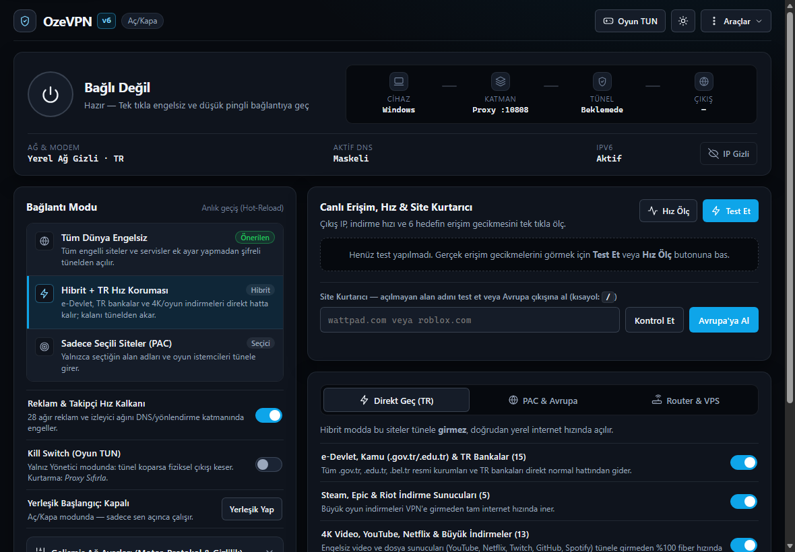
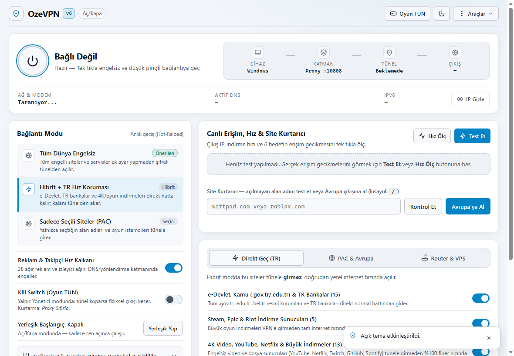
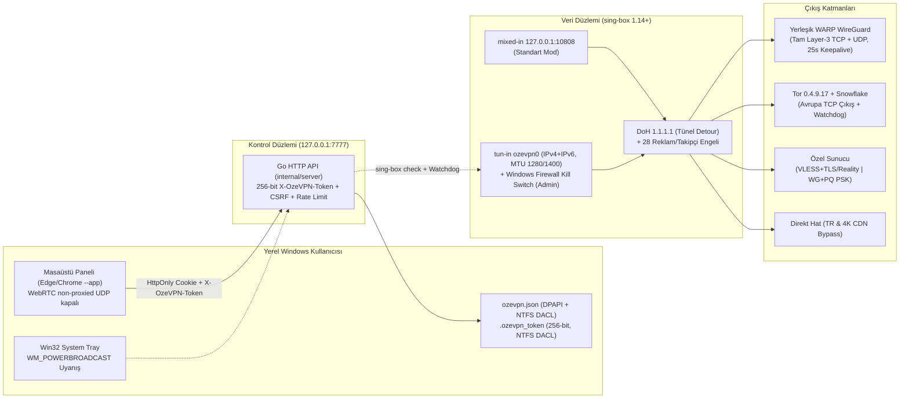

<div align="center">

<picture>
  <source media="(prefers-color-scheme: dark)" srcset="assets/banner-dark.svg">
  <source media="(prefers-color-scheme: light)" srcset="assets/banner-light.svg">
  
</picture>

<br/>
<br/>

[](https://github.com/KeremKalyoncu/ozevpn/actions/workflows/ci.yml)
[](https://github.com/KeremKalyoncu/ozevpn/actions/workflows/codeql.yml)
[](https://scorecard.dev/viewer/?uri=github.com/KeremKalyoncu/ozevpn)
[](https://goreportcard.com/report/github.com/KeremKalyoncu/ozevpn)
[](https://github.com/KeremKalyoncu/ozevpn/releases)
[](LICENSE)

**Sıfır üçüncü parti Go/npm bağımlılıklı, tek-dosya (`.exe`), yerleşik Cloudflare WARP WireGuard (`TCP+UDP`) + Avrupa Tor hibrit motorlu, yerel Windows masaüstü VPN ve sansür aşım uygulaması.**

[Kurulum & İndir](#kurulum--hızlı-başlangıç) · [Mimari](#mimari) · [Güvenlik & Gizlilik](#güvenlik-ve-gizlilik-mimarisi) · [Doğrulama & Bütünlük](#doğrulama--tedarik-zinciri-bütünlüğü) · [Katkı Rehberi](CONTRIBUTING.md)

</div>

---

## Neden OzeVPN?

Türkçe **"Öz"** *(çekirdek, saf, aracısız)* ve el değmemiş doğal geçit **Oze** kavramlarından adını alan **OzeVPN**, abonelik satmayan, telemetri toplamayan ve Electron şişkinliği taşımayan saf bir yerel tünel denetleyicisidir.

| Özellik | Klasik Ücretsiz VPN'ler | OzeVPN v6.1 |
| :--- | :--- | :--- |
| **Harici Kod Bağımlılığı** | Yüzlerce npm/Electron/SDK paketi | **`0` harici Go/npm bağımlılığı** (saf stdlib + `<120 KB` Vanilla UI) |
| **Oyun UDP (Roblox Error 279 / Discord Ses)** | Çoğu ücretsiz proxy yalnızca TCP | **Yerleşik saf-Go WARP WireGuard (Tam Layer-3 TCP+UDP, `MTU 1280`, `25s` keepalive)** |
| **TR Bankalar & 4K İndirme Hızı** | Tüm trafik tünele girer, hız düşer | **Akıllı Hibrit Split:** `.gov.tr`, bankalar ve 4K/Steam CDN'leri direkt fiber hızında |
| **AB Konum Gerektiren Siteler** | Bölge kilitli veya ücretli | **Paralel Avrupa Tor + Snowflake WebRTC köprüsü** (harici kurulumsuz) |
| **Sızıntı & Kapanma Koruması** | Çökünce proxy/IP sızar | **Dual-stack IPv6 TUN + DoH Detour + Windows Firewall Fail-Closed Kill Switch** |
| **Gizlilik & Hesap** | Hesap, e-posta, log, analitik | **Sıfır hesap, sıfır sunucu, sıfır telemetri**, DPAPI + NTFS DACL yerel koruma |

---

## Arayüz (Signal Cockpit UI)

| Koyu Tema (Obsidian Cockpit) | Açık Tema (Cool Porcelain) |
| :---: | :---: |
|  |  |

---

## Öne Çıkan Özellikler

- **Tek Dosya Masaüstü Uygulaması (`dist/OzeVPN.exe`):** `sing-box 1.14.4`, `Tor 0.4.9.17`, `lyrebird` (Snowflake WebRTC PT) ve GeoIP veritabanlarını `5/5` SHA-256 doğrulamayla tek ikilide toplar. Yerel Edge/Chrome `--app` penceresi ve Win32 System Tray (özel kalkan ikonu) ile çalışır.
- **Yerleşik Cloudflare WARP WireGuard (Tam Layer-3 TCP + UDP):**
  - `sing-box 1.14+` içinde doğrudan çalışan yerel WireGuard uç noktası (`warp-fast`) otomatik X25519 anahtar çiftiyle kaydolur ve özel anahtarı Windows **DPAPI + NTFS DACL** ile saklar.
  - **Roblox (RakNet UDP / Error 279 koruması)**, **Discord Ses (UDP)** ve çevrimiçi oyunlar için tam UDP tüneli, `MTU 1280` eşitlemesi ve `25 sn` CGNAT keepalive ile çalışır; UDP engellenen ağlarda otomatik `warp-cli` / Tor yedeğine düşer.
- **Paralel Hibrit Çıkış Motoru (4 Profil):**
  - **Hibrit (`hybrid_eu`, Varsayılan):** TR resmi (`.gov.tr`, `.edu.tr`), bankalar ve 4K/oyun indirme CDN'leri direkt tam hızda; Roblox, Discord ve genel internet yerleşik WARP WireGuard (TCP+UDP) üzerinden; AB konumu gerektiren siteler (`paypal.com`, `booking.com`, `wattpad.com` ve kullanıcı listesi) yalnızca TCP olarak Avrupa Tor üzerinden akar.
  - **Saf Avrupa Tor (`tor_eu`):** Tüm TCP trafiğini Avrupa Tor (+ isteğe bağlı Snowflake köprü) üzerinden çıkarır.
  - **Sadece Hızlı WARP (`warp_fast`):** En düşük gecikmeli tam TCP+UDP tüneli.
  - **Özel Sunucu (`custom`):** `VLESS+TLS/Reality`, **WireGuard `.conf` (Post-Quantum `PresharedKey` destekli)** veya izinli `sing-box` JSON.
- **Standart Proxy + Yönetici (`Oyun TUN`) Akıllı Geçişi:**
  - **Standart Mod:** UAC izni istemeden Windows WinINET proxy (`127.0.0.1:10808`) üzerinden tarayıcıları korur.
  - **Yönetici Modu (`Oyun TUN`):** `-no-browser -takeover` ile mevcut pencereyi kapatmadan devralır; çift yığınlı (`IPv4 + IPv6`, WireGuard ile `MTU 1280`, diğer profillerde `MTU 1400`) `ozevpn0` TUN arayüzü açar, oyun UDP trafiğini yakalar ve isteğe bağlı **Windows Firewall Fail-Closed Kill Switch**'i etkinleştirir.
- **Yerel Arayüz ([docs/DESIGN.md](docs/DESIGN.md)):** Gerçek verili **Canlı Tünel Rota Şeması** (`Cihaz → Katman → Tünel → Çıkış`), bağlanınca otomatik `/api/trace` çıkış konumu tespiti, inline SVG ikonlar, erişilebilir CSS Switch'ler, klavye kısayolları (`Alt+C`, `Alt+T`, `/`) ve `<= 120 KB` toplam gömülü web bütçesi.

---

## Mimari



---

## Güvenlik ve Gizlilik Mimarisi

| Katman | Uygulanan Güvenlik Kontrolü |
| :--- | :--- |
| **Yerel IPC & Kimlik** | Her oturumda `crypto/rand` 256-bit token (`/auth?t=...` → `HttpOnly; SameSite=Strict` + tüm mutasyonlarda zorunlu `X-OzeVPN-Token`), `Host` DNS-Rebinding & `Origin`/`Sec-Fetch-Site` CSRF engeli, rate/concurrency limit. |
| **Anahtar & Dosya İzolasyonu** | `custom_server` ve yerleşik WARP WireGuard özel anahtarları Windows **DPAPI** (`CryptProtectData`) ile şifrelenir; `ozevpn.json`, `.ozevpn_token`, runtime ve log dosyalarına NTFS DACL uygulanır. Bağlantı kesildiğinde `sing-box-active.json` silinir. |
| **Protokol Sertleştirme** | Şifresiz `vless://`, uzak düz metin `socks5://`, `allowInsecure=1` ve ham JSON `tls.insecure:true` reddedilir; WireGuard resmi Post-Quantum `PresharedKey` desteklenir; hata çıktılarında sırlar maskelenir (`RedactSecrets`). |
| **Sızıntı Koruması** | Dual-stack `IPv4 + IPv6` TUN (`fdfe:dcba:9876::1/126`, WireGuard ile `MTU 1280`), aktif tünel `detour`'lu şifreli DoH DNS (`1.1.1.1`), bağlantı geçişlerinde `ipconfig /flushdns`, UI WebRTC non-proxied UDP engeli ve opsiyonel LAN izolasyonu. |
| **Kill Switch & Dayanıklılık** | Yönetici TUN modunda WFP tabanlı Windows Firewall `OzeVPN-KS-*` + `blockoutbound` Kill Switch, çift `sing-box` + `tor` Watchdog (5s→60s üstel backoff), uyku/uyanma (`WM_POWERBROADCAST`) ve ağ değişimi kurtarması. |

> [!NOTE]
> **Kapsam Şeffaflığı:** Standart (yönetici olmayan) mod yalnızca Windows WinINET proxy kullanan tarayıcı/uygulamaları korur; tüm sistem (`IPv4+IPv6+UDP`) ve Kill Switch koruması için paneldeki **Oyun TUN** (Yönetici) modunu kullanın. Ayrıntılar için bkz. [PRIVACY.md](PRIVACY.md).

---

## Doğrulama & Tedarik Zinciri Bütünlüğü

Her sürüm ve commit şu otomatik güvenlik kapılarından geçer:
- **CI Doğrulama (`.github/workflows/ci.yml`):** `gofmt`, `go vet`, `staticcheck`, `node --check`, `go test -race -cover ./...` (14 paket + 36-kombinasyon resmi `sing-box check` matrisi), fuzzing (`FuzzCleanDomain`, `FuzzParseCustomOutbound`), `govulncheck`, secret taraması ve **canlı Windows `ozevpn.exe` HTTP/güvenlik duman testi**.
- **Statik Güvenlik & Tedarik Zinciri:** SHA-pinli GitHub Actions, `CodeQL` SAST (`Go` + `JavaScript`), Linux Foundation **OpenSSF Scorecard**, `Dependabot`, `5/5` çalışma zamanı SHA-256 doğrulaması (`BINARY_CHECKSUMS.txt`) ve **CycloneDX 1.5 SBOM**.
- **Kriptografik Derleme Kanıtı (SLSA Attestation):** GitHub Release ikililerini Sigstore ile doğrulamak için:
  ```powershell
  gh attestation verify OzeVPN-core.exe -R KeremKalyoncu/ozevpn
  ```

---

## Kurulum & Hızlı Başlangıç

### Son Kullanıcı (Tek Dosya `.exe`)
1. [Releases](https://github.com/KeremKalyoncu/ozevpn/releases) sayfasından `OzeVPN.exe` dosyasını indirin ve isteğe bağlı olarak `OzeVPN.exe.sha256` ile özetini doğrulayın.
2. Çift tıklayın — kontrol paneli otomatik olarak güvenli oturumla açılır ve Sistem Tepsisine (Tray) yerleşir.
3. Tam sistem / oyun UDP / Kill Switch koruması için üst çubuktan **Oyun TUN** butonuna tıklayın.
4. **Tam Temiz Kaldırma:**
   ```powershell
   .\dist\OzeVPN.exe -uninstall
   ```

### Geliştirici: Çalıştırma, Test ve Tek-EXE Derleme
Gereksinimler: **Go 1.22+** (CI'da **Go 1.26+**, Windows `amd64`) ve `BINARY_CHECKSUMS.txt` ile eşleşen `bin/` ikilileri.

```powershell
# Kaynaktan doğrudan çalıştırma
go run ./cmd/ozevpn

# Biçim, statik analiz, yarış algılayıcı ve tüm testler
gofmt -l .
go vet ./...
go test -race -cover ./...

# Canlı Baseline vs Tünel performans & p50/p95/p99 benchmark
go run ./tools/bench -samples 10 -bytes 3000000

# 5/5 SHA256 doğrulamalı tek-dosya EXE + CycloneDX SBOM derlemesi
.\scripts\build-single-exe.ps1
```

> **Üretilmiş kaynak notu:** `cmd/ozevpn/rsrc_windows_amd64.syso` dosyası Windows EXE ikonu ve sürüm kaynağı için `assets/ozevpn.rc` dosyasından (`windres`) üretilir; elle düzenlenmez. İkonlar `go run ./tools/genicon` ile tek kaynak olan `assets/` içine yenilenebilir.

---

## Tüm Ev (OpenWrt Router) & Kendi VPS'in

- **OpenWrt Router (`sing-box 1.14+` + SQM/CAKE):** Panelden `sing-box-openwrt.json` dışa aktarın ve [router/openwrt-setup.sh](router/openwrt-setup.sh) ile [router/README.md](router/README.md) adımlarını izleyin.
- **Kendi Avrupa VPS'in (WireGuard + PQ PSK + BBR + UFW):** Ubuntu/Debian sunucuda [vps/setup-vps.sh](vps/setup-vps.sh) betiğini çalıştırın — default-deny UFW, SSH sertleştirme, Cloud Metadata (`169.254.0.0/16`) engeli, `chrony` ve `unattended-upgrades` otomatik kurulur.

---

## Dokümantasyon

| Belge | İçerik |
| :--- | :--- |
| [LICENSE](LICENSE) | GNU General Public License v3.0 (GPL-3.0) |
| [CHANGELOG.md](CHANGELOG.md) | Sürüm geçmişi ve önemli değişiklikler |
| [SECURITY.md](SECURITY.md) | Güvenlik savunma katmanları, acil Proxy/Kill Switch kurtarma ve güncelleme prosedürü |
| [PRIVACY.md](PRIVACY.md) | Veri akışları, harici çağrılar, anonimlik sınırları ve saklama politikası |
| [CONTRIBUTING.md](CONTRIBUTING.md) | Geliştirme ilkeleri, PR kontrol listesi ve katkı kuralları |
| [CODE_OF_CONDUCT.md](CODE_OF_CONDUCT.md) | Topluluk davranış kuralları (Contributor Covenant v2.1) |
| [docs/ARCHITECTURE.md](docs/ARCHITECTURE.md) | Mimari Karar Kayıtları (`ADR-001` – `ADR-008`) |
| [docs/DESIGN.md](docs/DESIGN.md) | Signal Cockpit arayüz tasarım sistemi ve erişilebilirlik kuralları |
| [docs/THREAT-MODEL.md](docs/THREAT-MODEL.md) | Varlık envanteri, güven sınırları ve tam STRIDE matrisi |
| [docs/OPERATIONS.md](docs/OPERATIONS.md) | İstemci SLO hedefleri, `/api/healthz`, `/api/metrics` ve anahtar rotasyon runbook'u |
| [THIRD_PARTY_LICENSES.md](THIRD_PARTY_LICENSES.md) | Gömülü üçüncü parti bileşenler ve lisans bildirimi (SBOM) |
