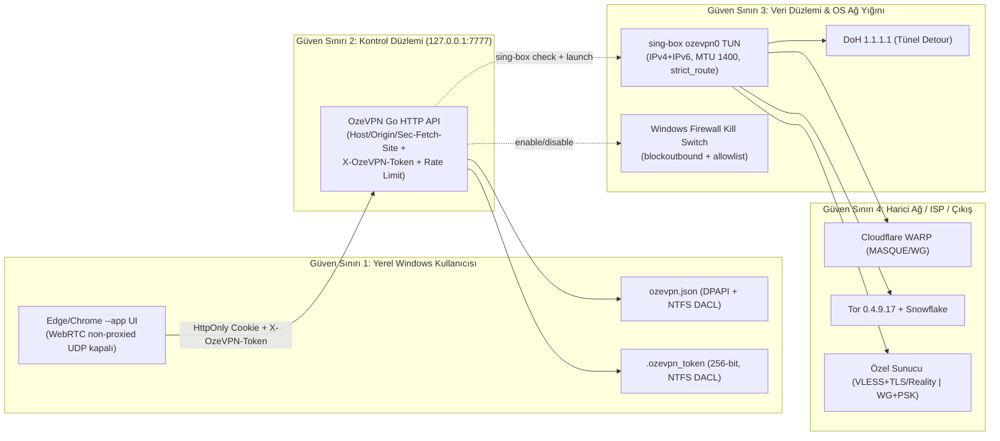

# OzeVPN v6 — Tehdit Modeli, Güven Sınırları ve STRIDE Matrisi

## 1. Varlık Envanteri ve Güven Sınırları

## 2. Saldırgan Modeli
1. **Harici Web Sitesi / Kötü Niyetli Tarayıcı Sekmesi:** CSRF, DNS Rebinding ve DOM XSS ile `127.0.0.1:7777` kontrol API'sine ulaşmaya çalışan saldırgan.
2. **Aynı Makinedeki Yetkisiz Yerel Süreç / İkinci Windows Kullanıcısı:** Yönetici (`Oyun TUN`) modunda çalışan `OzeVPN`'in API'sine komut göndermeye veya `ozevpn.json` / `sing-box-active.json` içindeki özel anahtarları okumaya çalışan saldırgan.
3. **Pasif/Aktif Ağ Gözlemcisi (ISP / Halka Açık Wi-Fi):** DPI engelleme, DNS zehirleme, IPv6/WebRTC/çökme anı sızıntısı ve düz metin protokol downgrade fırsatlarını kollayan saldırgan.
4. **Tedarik Zinciri Saldırganı:** Paketlenen `sing-box`, `tor`, `lyrebird` veya GeoIP dosyalarını değiştirmeye çalışan saldırgan.

## 3. STRIDE Tehdit ve Kontrol Matrisi

| STRIDE | Hedef Varlık | Tehdit Senaryosu | Uygulanan Kontrol | Kalan Risk |
| :--- | :--- | :--- | :--- | :--- |
| **S — Spoofing** | `127.0.0.1:7777` API | Yetkisiz yerel süreç veya harici site isteği | 256-bit `X-OzeVPN-Token` + `HttpOnly; SameSite=Strict` + `Host`/`Origin`/`Sec-Fetch-Site` (`main.go`) | Aynı Windows kullanıcısı yetkisindeki kötü amaçlı yazılım `.ozevpn_token` okuyabilir |
| **T — Tampering** | `ozevpn.json`, `sing-box-active.json`, ikililer | Config manipülasyonu veya ikili değiştirme | NTFS DACL (`secfs`), `sing-box check` ön doğrulaması, 5 dosyalı `BINARY_CHECKSUMS.txt`, CI `govulncheck` | Yönetici hesabının kendisi ele geçirilirse tüm sistem etkilenir |
| **R — Repudiation** | Kritik API işlemleri | Config/bağlantı/reset izinin kaybolması | Yapılandırılmış `slog` audit logları (`audit_action`, `security_blocked_*`) + `/api/metrics` | Yerel loglar cihaz sahibi tarafından silinebilir |
| **I — Info Disclosure** | Özel sunucu anahtarları, IP/DNS/IPv6 | Anahtar okuma, IPv6 bypass, DNS/WebRTC sızıntısı | Windows DPAPI + NTFS DACL, dual-stack IPv6 TUN, DoH detour, `ipconfig /flushdns`, WebRTC politikası, `RedactSecrets` | Standart (non-admin) proxy modunda proxy-dışı/UDP uygulamalar kapsam dışıdır |
| **D — Denial of Service** | Kontrol API & Alt Süreçler | İstek seli, `sing-box`/`tor` çökmesi, uyku/ağ değişimi | `withRateLimit`, `withConcurrencyLimit`, `sing-box` + `tor` Watchdog (5s→60s backoff), `WM_POWERBROADCAST`, 2 MB log tavanı | Kasıtlı ağ kesintisinde Kill Switch aktifken internet kasıtlı bloke kalır |
| **E — Elevation of Privilege** | Admin `Oyun TUN` Süreci | Düşük yetkili süreçten Admin API kontrolü veya güvensiz outbound enjeksiyonu | 256-bit IPC token + sıkı outbound allowlist + plaintext VLESS/SOCKS5 & `tls.insecure` reddi | UI ve motor tek süreçtedir; tam servis ayrımı taşınabilir tek-EXE tasarımıyla takas edilmiştir |
